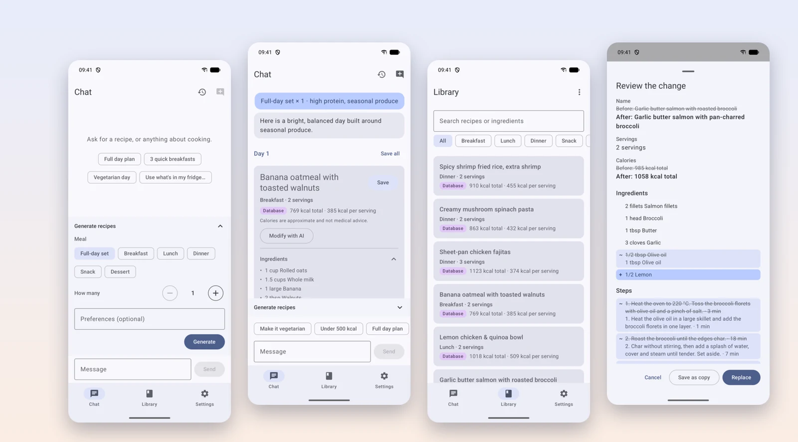
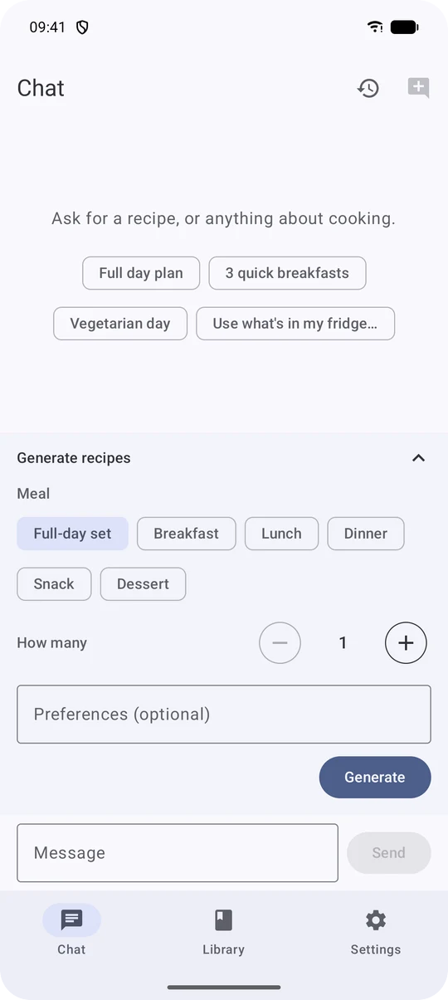
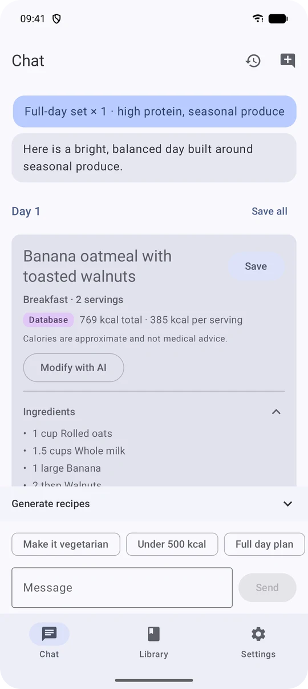
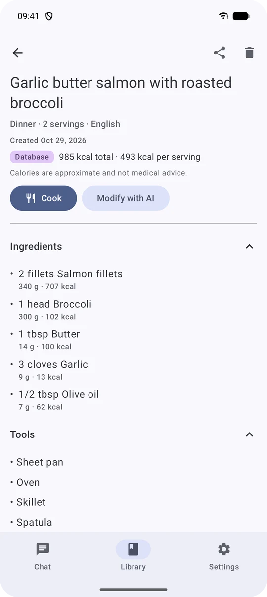
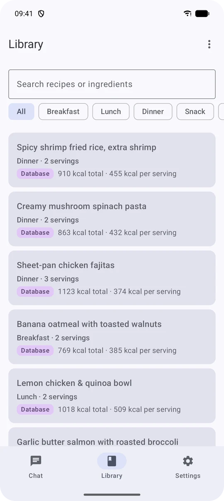
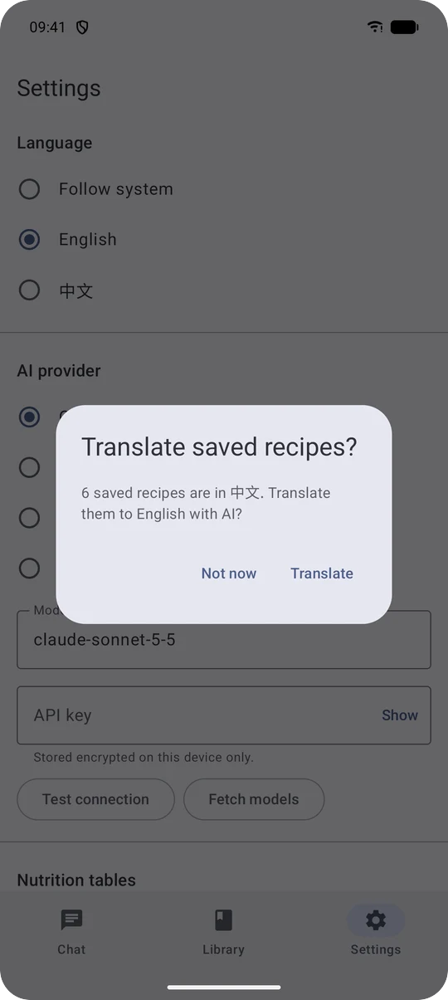
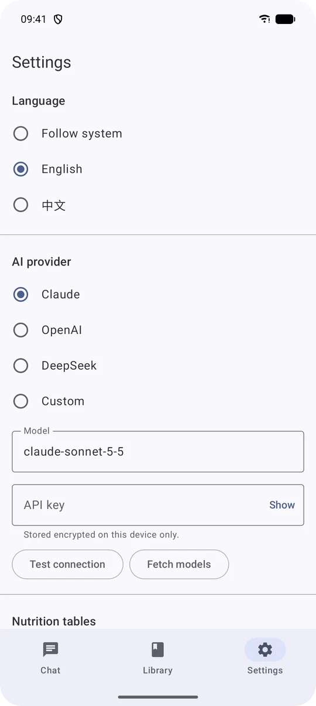

<div align="center">

# 🍲 RecipeCraft

**Chat your way to dinner.** 🥢 RecipeCraft is an Android app that turns a conversation with the LLM
you choose into structured recipes. Each one comes with ingredients, kitchen tools, numbered steps
and calories you can trust.

**English** · [简体中文](README.zh-CN.md)




</div>

---

## ✨ Why RecipeCraft?

Ask a chatbot for recipes and you get a wall of text. You can't save it, the calories are guesses,
and asking for "no oven" rewrites everything. RecipeCraft keeps the chat but makes the output
**structured, checkable and yours**:

- 🍳 **Real recipe cards, not prose.** Ingredients with quantities, tools, numbered steps with
  timings, servings and calories, streamed in as the model writes.
- 🔥 **Calories with a source.** Every ingredient is matched against USDA FoodData Central, and a
  card says plainly whether its total comes from the **Database** or is an **≈ AI estimate**.
- ✏️ **Change one recipe, keep the rest.** "Make it vegetarian" touches only that recipe, and you
  review a diff before anything is replaced.
- 🔑 **Your model, your key.** Claude, OpenAI, DeepSeek or any OpenAI- or Anthropic-compatible
  endpoint. The key is encrypted on the device and goes nowhere else.
- 🌏 **English and 中文 throughout.** The UI, the prompts and the recipes themselves, with
  one-tap translation of your saved recipes when you switch languages.
- 📱 **Phone, tablet, foldable and flip cover screen.** It even has a one-step-at-a-time Cook mode
  for the Galaxy Z Flip cover display.

💚 Free, personal and non-commercial: no accounts, ads, analytics or payments.

## 📸 Tour

### 💬 Ask for a whole day, or just dessert

Pick a **full-day set** (breakfast, lunch and dinner) or a single meal type, choose **how many**
(1–10) and add preferences. You can also just chat. Preset chips cover the common asks, and your
conversations are saved so you can pick one up later.

<p align="center">
  
  &nbsp;
  
</p>

### 🔥 Calories you can check

For each ingredient the model returns grams and a hidden English match key. RecipeCraft looks the
ingredient up in the bundled USDA table (about 500 common foods) and in any **nutrition tables you
import** as CSV, then shows the per-ingredient breakdown. If any ingredient fails to match, the card
falls back to the model's figure and labels it **≈ AI estimate**, so a guess never passes as data.

<p align="center">
  
  &nbsp;
  
</p>

### ✏️ Modify with AI, then review the diff

Tap **Modify with AI** on any card or saved recipe, pick a quick change (*Vegetarian*, *Fewer
calories*, *No oven*, *Swap an ingredient*) or type your own. RecipeCraft shows what changed:
ingredients and steps that were added, removed or edited, and the calorie difference. Then you choose
**Replace** or **Save as copy**. The other recipes in a set are left alone.

<p align="center">
  
  &nbsp;
  
</p>

### 📚 A library that keeps up

Save recipes one at a time or a whole set at once. Filter by meal and search by name or ingredient.
Delete with undo, **export and import** everything as JSON, or share a single recipe as text. Each
recipe remembers the language it was written in, and when you switch the app language, RecipeCraft
offers to translate your saved recipes with the LLM. It keeps ids, grams and calories and changes
only the text.

### 📱 From a tablet to the cover screen

The layouts adapt to compact, medium and expanded windows. On a tablet or an unfolded foldable the
library becomes a list-detail view. On the **Galaxy Z Flip cover screen** every screen fits without
horizontal scrolling, and **Cook mode** shows one large step at a time with a built-in timer. You
can use it one-handed and keep your place when you unfold.

<p align="center">
  
</p>
<p align="center">
  
  &nbsp;
  
</p>

## 🤖 Supported providers

| Provider | Endpoint | Default model |
|---|---|---|
| **Claude** (Anthropic) | `https://api.anthropic.com` | `claude-sonnet-5-5` |
| **OpenAI** | `https://api.openai.com/v1` | pick one with **Fetch models** |
| **DeepSeek** | `https://api.deepseek.com` | `deepseek-chat` |
| **Custom** | any `https://` base URL | your choice; OpenAI- *or* Anthropic-compatible protocol |

Replies stream over server-sent events. **Test connection** checks your key and endpoint before
your first chat.

<p align="center">
  
</p>

## 🔒 Privacy

- 🔐 Your API key is sealed with **Tink AEAD** under a non-exportable **Android Keystore** key, and it
  is excluded from cloud backup and device transfer.
- 🌐 The only network traffic is to the LLM provider **you** configure. There is no analytics, crash
  reporting or telemetry.
- 🙈 Keys never appear in logs or exports, and release builds never log request or response bodies.
- 📴 Imported nutrition tables stay on the device and are never exported.

## 🚀 Getting started

### 📦 Install

There's no store listing yet, so clone the repository and build it from source:

```bash
./gradlew installDebug        # with an emulator or a device (Android 14+) attached
```

Open **Settings**, pick a provider, paste your API key and tap **Test connection**. Then head to
**Chat** and ask for something delicious. 😋

### 🧰 Requirements

- JDK 21 (point `JAVA_HOME` at it)
- Android SDK with platform 37; the app runs on Android 14 (API 34) and later

### 🧪 Build and test

```bash
./gradlew test assembleDebug lint koverVerify   # unit tests, build, lint, 80% coverage gate
./gradlew connectedDebugAndroidTest             # instrumented tests (emulator or device attached)
./gradlew assembleRelease                       # R8-minified release APK
```

## 🥗 Import your own nutrition table

**Settings › Nutrition tables › Import CSV** takes a UTF-8 file with a header row:

```csv
name,aliases,kcal_per_100g
鸡蛋,鸡子|蛋,144
番茄,西红柿,18
```

`aliases` is optional and `|`-separated. Imported tables are matched **before** USDA: on the
Chinese display name in Chinese recipes and on the English name in English ones. Rows that fail
validation are skipped and counted in the import summary. Only import tables you're entitled to use.
For example, the China Food Composition Table is copyrighted, so RecipeCraft doesn't ship,
download or link to it.

## 🤝 Contributing

Issues and pull requests are welcome. A few house rules, explained in full in
[`AGENTS.md`](AGENTS.md):

- Commits follow [Conventional Commits](https://www.conventionalcommits.org/), e.g.
  `feat(library): filter saved recipes by meal`.
- `./gradlew test assembleDebug lint koverVerify` passes before every commit.
- Every user-facing string and prompt exists in **both** `values/` and `values-zh/`.

## 🙏 Acknowledgments

- Calorie data: [USDA FoodData Central](https://fdc.nal.usda.gov/) (Foundation Foods, April 2026,
  and SR Legacy, 2018), U.S. Department of Agriculture, Agricultural Research Service, published
  under CC0 1.0. USDA does not endorse RecipeCraft.

> [!NOTE]
> Calories are approximate and not medical advice.
