<div align="center">


# RecipeCraft

**聊着天，就把晚饭定了。** 🥢 RecipeCraft 是一款 Android 应用：和你自己选的大模型聊几句，就能得到结构清晰的食谱，
食材、厨具、分步做法一应俱全，热量也有据可查。

[English](README.md) · **简体中文**


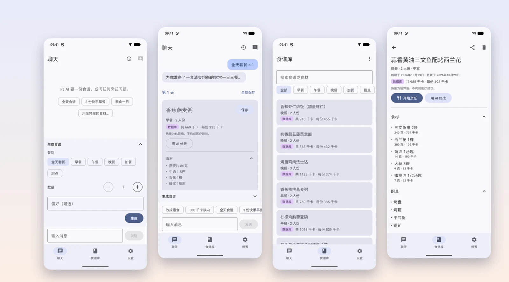

</div>

---

## ✨ 为什么用 RecipeCraft？

直接找聊天机器人要食谱，往往得到一大段文字：存不下来，热量全靠猜，说一句“不用烤箱”它又从头重写一遍。
RecipeCraft 保留了聊天的方式，但让结果**结构化、可核对、真正归你所有**：

- 🍳 **是食谱卡片，不是大段文字。** 带用量的食材、厨具、带时长的分步做法、份数和热量，随模型输出实时呈现。
- 🔥 **热量有出处。** 每种食材都会与 USDA FoodData Central 数据比对，卡片上清楚标明总热量来自**数据库**，还是**≈ AI 估算**。
- ✏️ **只改一道，其余不动。** “改成素食”只影响这一道菜，替换之前你可以先逐项查看改动。
- 🔑 **模型你选，密钥你管。** 支持 Claude、OpenAI、DeepSeek，以及任何兼容 OpenAI 或 Anthropic 协议的接口。密钥加密保存在本机，不会发往别处。
- 🌏 **中英文全面支持。** 界面、提示词和食谱本身都有中英两版。切换语言时，还能一键把已保存的食谱翻译过去。
- 📱 **手机、平板、折叠屏，连翻盖外屏都适配。** 在 Galaxy Z Flip 外屏上还有一次只显示一步的烹饪模式。

💚 免费、个人、非商业：没有账号、广告、统计，也不收费。

## 📸 功能一览

### 💬 一整天的三餐，或者只要一道甜点

选择**全天套餐**（早餐、午餐、晚餐）或单一餐别，设定**数量**（1–10），再写上你的偏好；也可以直接聊天。
常用需求有快捷标签，对话会自动保存，随时可以接着聊。

<p align="center">
  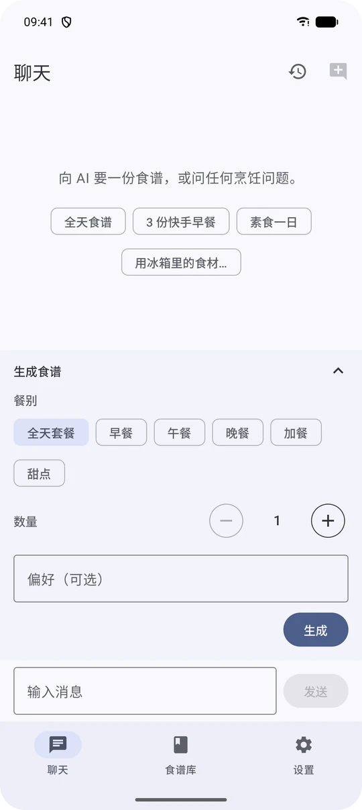
  &nbsp;
  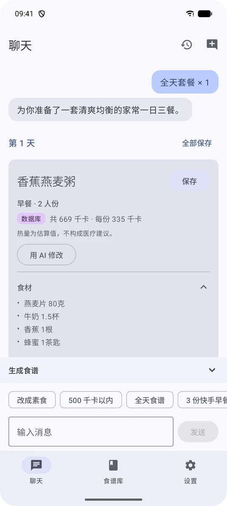
</p>

### 🔥 热量经得起核对

模型会为每种食材给出克数和一个隐藏的英文匹配名。RecipeCraft 用它查找内置的 USDA 营养表（约 500 种常见食材）
以及你**导入的营养成分表**（CSV），并逐项列出每种食材的热量。只要有一种食材没匹配上，卡片就改用模型给出的数字，
并标注为**≈ AI 估算**，不会把估算冒充成数据。

<p align="center">
  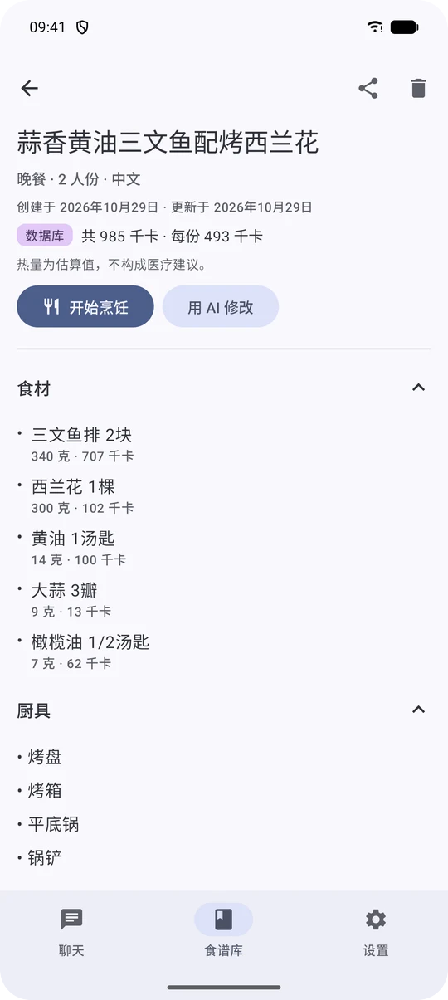
  &nbsp;
  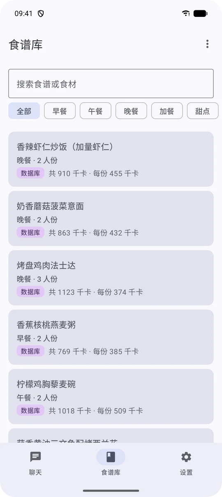
</p>

### ✏️ 用 AI 修改，先看改动再决定

在任意卡片或已保存的食谱上点**用 AI 修改**，选一个快捷修改（*素食*、*减少热量*、*不用烤箱*、*换一种食材*），
或者自己写要求。RecipeCraft 会列出改了什么：新增、删除或调整了哪些食材和步骤，热量前后差多少。然后由你选择
**替换**或**另存为副本**。同一套餐里的其他食谱保持不变。

<p align="center">
  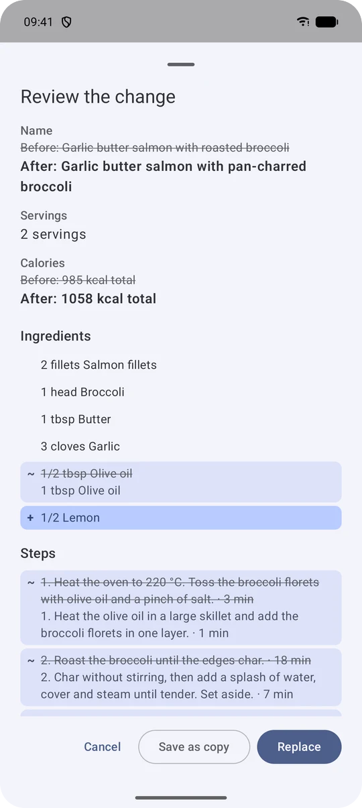
  &nbsp;
  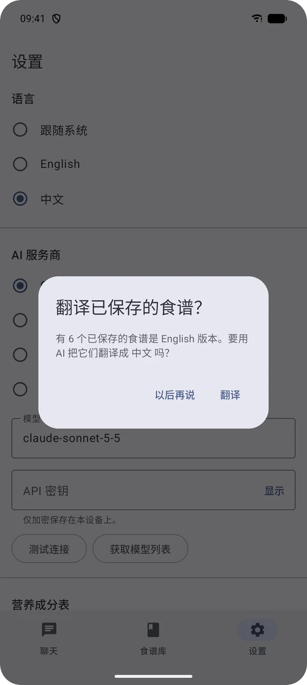
</p>

### 📚 跟得上你的食谱库

可以一道一道保存，也可以整套一起保存。按餐别筛选，按菜名或食材搜索。删除可以撤销，全部食谱可以**导出、导入**为 JSON，
单道食谱可以以文字形式分享。每道食谱都会记住生成时的语言，切换应用语言后，RecipeCraft 会询问是否用大模型翻译已保存的食谱：
保留 id、克数和热量，只翻译文字。

### 📱 从平板到翻盖外屏

界面会根据窄、中、宽三种窗口自动调整。在平板或展开的折叠屏上，食谱库变成左侧列表、右侧详情的双栏布局。
在 **Galaxy Z Flip 外屏**上，每个页面都不需要横向滚动，**烹饪模式**一次只显示一个大字步骤，并自带计时器，
单手就能操作，展开手机后也会停在原来的步骤。

<p align="center">
  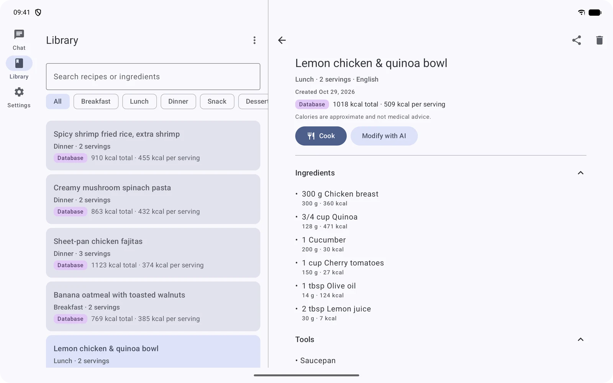
</p>
<p align="center">
  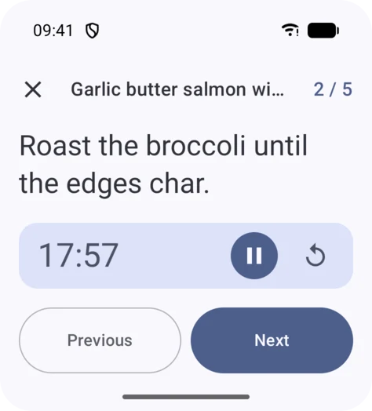
  &nbsp;
  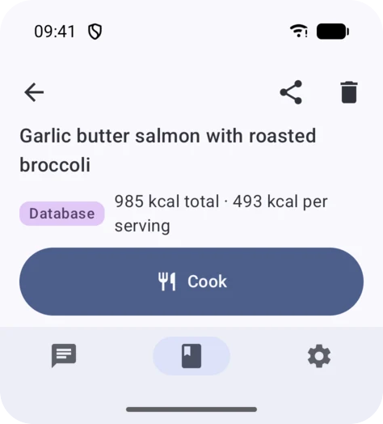
</p>

## 🤖 支持的服务商

| 服务商 | 接口地址 | 默认模型 |
|---|---|---|
| **Claude**（Anthropic） | `https://api.anthropic.com` | `claude-sonnet-5-5` |
| **OpenAI** | `https://api.openai.com/v1` | 用**获取模型列表**选择 |
| **DeepSeek** | `https://api.deepseek.com` | `deepseek-chat` |
| **自定义** | 任意 `https://` 地址 | 自选模型，兼容 OpenAI *或* Anthropic 协议 |

回复通过 SSE 流式返回。第一次聊天前，可以先用**测试连接**检查密钥和接口是否可用。

<p align="center">
  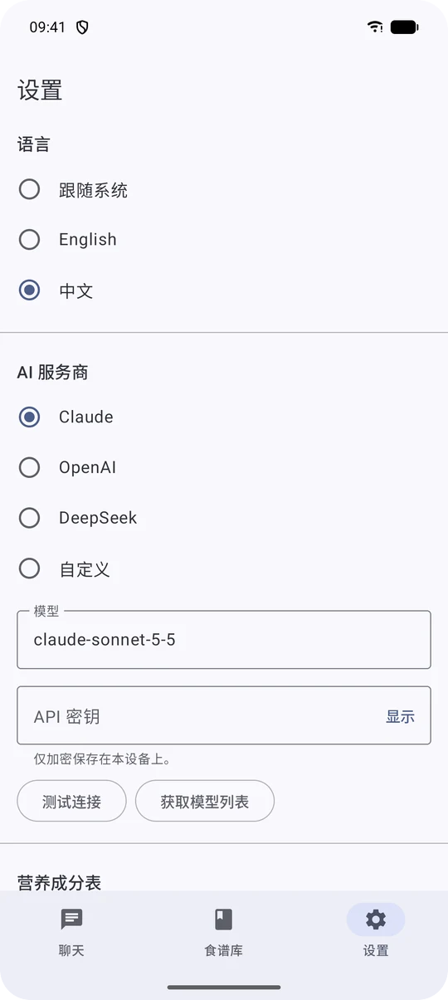
</p>

## 🔒 隐私

- 🔐 API 密钥用 **Tink AEAD** 加密，密钥本身存放在不可导出的 **Android Keystore** 中，并且不会进入云备份或设备迁移。
- 🌐 唯一的网络请求发往**你自己**配置的大模型服务商。没有统计、崩溃上报或任何遥测。
- 🙈 密钥不会出现在日志和导出文件中，正式版也从不记录请求和响应内容。
- 📴 导入的营养成分表只保存在本机，永远不会被导出。

## 🚀 快速开始

### 📦 安装

目前还没有上架应用商店，请克隆仓库后从源码构建：

```bash
./gradlew installDebug        # 需要连接模拟器或 Android 14 及以上的设备
```

打开**设置**，选择服务商，粘贴 API 密钥，点**测试连接**。然后去**聊天**页，问问今天吃什么。😋

### 🧰 环境要求

- JDK 21（设置好 `JAVA_HOME`）
- 安装了 platform 37 的 Android SDK；应用支持 Android 14（API 34）及以上

### 🧪 构建与测试

```bash
./gradlew test assembleDebug lint koverVerify   # 单元测试、构建、lint、80% 覆盖率门槛
./gradlew connectedDebugAndroidTest             # 仪器测试（需连接模拟器或设备）
./gradlew assembleRelease                       # 经过 R8 压缩的正式版 APK
```

## 🥗 导入自己的营养成分表

**设置 › 营养成分表 › 导入 CSV**，文件为 UTF-8 编码，带表头：

```csv
name,aliases,kcal_per_100g
鸡蛋,鸡子|蛋,144
番茄,西红柿,18
```

`aliases` 可选，多个别名用 `|` 分隔。导入的表**优先于** USDA 匹配：中文食谱按中文名匹配，英文食谱按英文名匹配。
不合格的行会被跳过，并在导入结果中计数。请只导入你有权使用的数据。例如《中国食物成分表》受版权保护，所以
RecipeCraft 不内置、不下载、也不链接它。

## 🤝 参与贡献

欢迎提交 issue 和 pull request。几条约定（详见 [`AGENTS.md`](AGENTS.md)）：

- 提交信息遵循 [Conventional Commits](https://www.conventionalcommits.org/zh-hans/)，例如
  `feat(library): filter saved recipes by meal`。
- 每次提交前都要通过 `./gradlew test assembleDebug lint koverVerify`。
- 每条界面文字和每个提示词都要在 `values/` 和 `values-zh/` 中**同时**提供。

## 🙏 致谢

- 热量数据：[USDA FoodData Central](https://fdc.nal.usda.gov/)（Foundation Foods，2026 年 4 月版；SR Legacy，2018 年版），
  美国农业部农业研究局，以 CC0 1.0 发布。USDA 不为 RecipeCraft 背书。

> [!NOTE]
> 热量数据仅为估算，不构成医疗建议。
